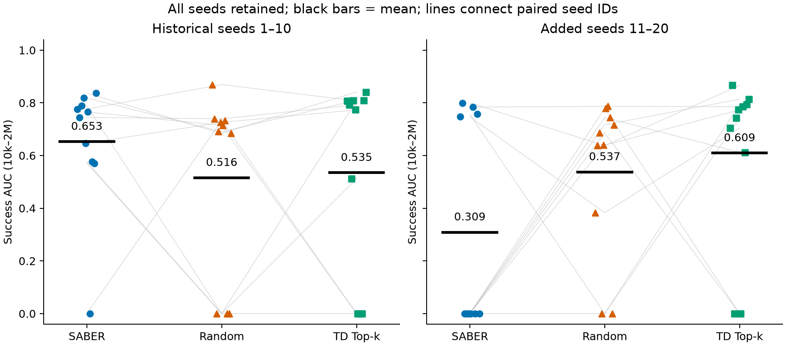
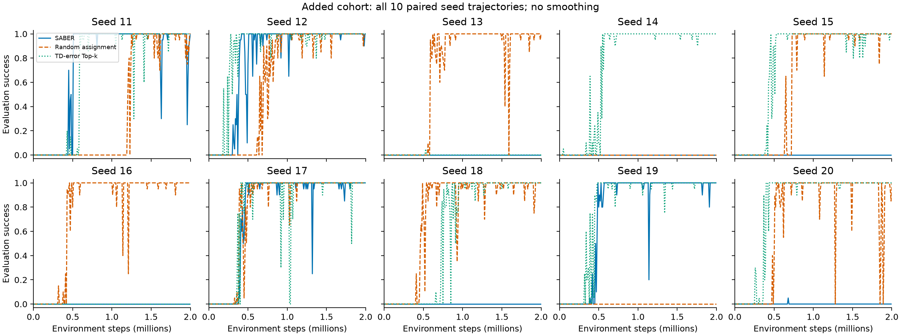
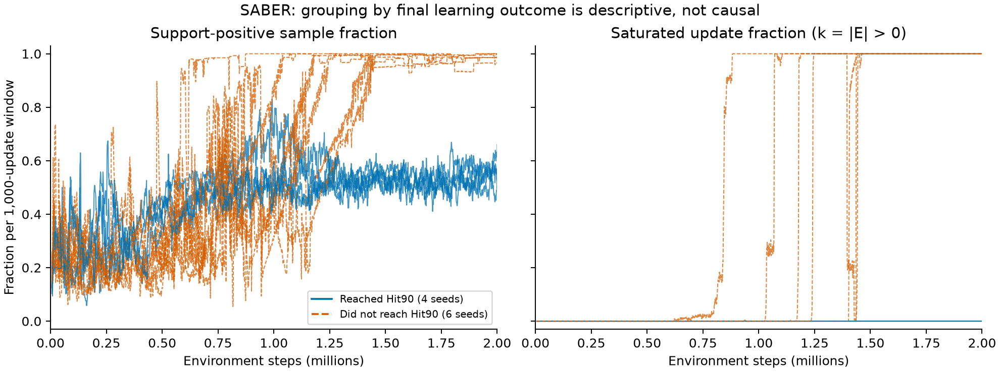
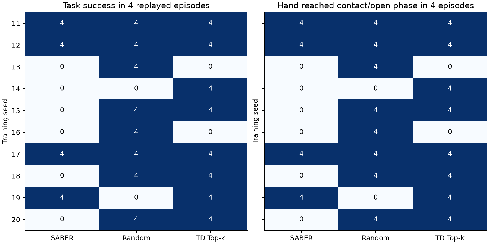
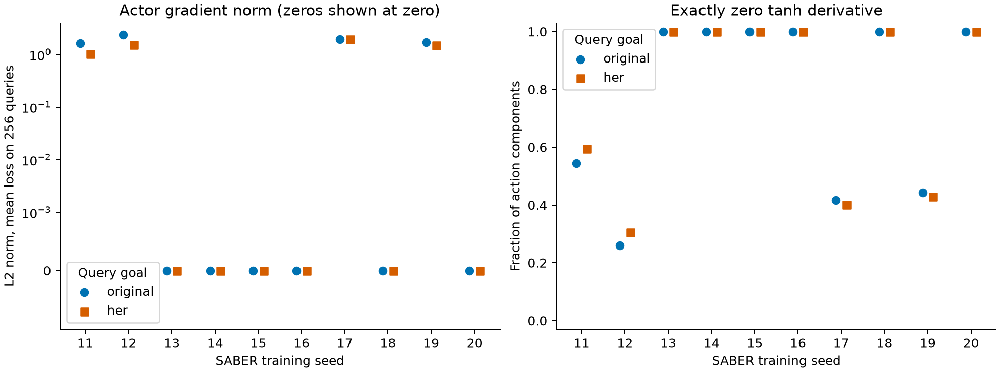
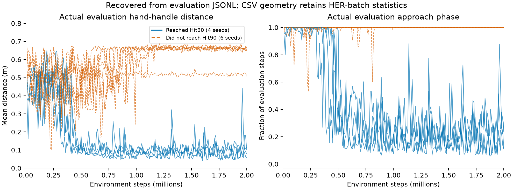

# SABER seed 11–20 성능 하락: 심층 사후 감사

- 작성: 2026-10-30T06:38:24.573925+00:00
- 범위: DrawerOpen–DDPG, 기존 1–10 공개 요약과 추가 11–20의 30개 완료 run. 모든 primary 결과와 실패 실행을 보존했다.
- 이 문서의 진단·그룹·검정은 결과를 본 뒤 수행한 탐색 분석이다. 새 본학습·optimizer update는 없다.

## 1. 현재 결론

**추가 cohort에서 SABER의 낮은 평균은 성공 학습 경로에 들어가지 못한 실행이 많아진 양상으로 설명된다. 그 초기 실패 경로가 왜 SABER에서 더 많아졌는지의 인과적 원인은 아직 확정할 수 없다.**
실패한 SABER 6개 모두 마지막 정책의 행동 성분이 ±1로 고정되고, replay의 original/HER goal query에서 tanh 도함수와 actor gradient가 0이었다. 평가에서 손잡이 접근 없이 위쪽·바깥쪽으로 움직였다. 최종 실패의 구체적인 기전은 출력 포화와 actor 학습 신호 소실로 확인되지만, SABER 배정이 이 경로에 더 자주 진입하게 했는지의 초기 인과경로는 아직 확인되지 않았다.
실패 후반에는 높은 support와 포화가 함께 관측된다. 이는 support가 성공·정확한 Q의 보증이 아님을 보여주지만, support 포화가 초기 실패를 일으켰다는 증거는 아니다.
원시 로그 정합성 검사와 36개 checkpoint의 index/support 검사에서 오류를 발견하지 못했다. 최종 정책의 원래 평가 reset 재실행에서도 0/100% 결과가 재현됐다. 이 감사가 모든 가능한 구현 오류를 배제하는 것은 아니다.

## 2. 기존·추가 cohort 결과

| 방법 | 기존 AUC | 추가 AUC | 변화 | 기존 Hit90 | 추가 Hit90 |
|---|---:|---:|---:|---:|---:|
| SABER | 0.652613 | 0.308794 | -0.343819 | 9/10 | 4/10 |
| Random assignment | 0.515678 | 0.537412 | +0.021734 | 7/10 | 8/10 |
| TD-error Top-k | 0.534623 | 0.609347 | +0.074724 | 7/10 | 8/10 |

Random/TD의 평균은 올라갔고 SABER만 내려갔다. 따라서 새 cohort 전체가 단순히 더 어려웠다는 설명만으로 세 방법의 차이를 충분히 설명할 수 없다. 그러나 환경 변화와 방법 사이의 상호작용까지 배제한 것은 아니다.
새 10개에서 SABER−TD AUC의 고정 95% CI는 [−0.530202, −0.083792], nominal Bonferroni 97.5% CI는 [−0.557137, −0.070653]다. 통합 20개의 두 비교 CI는 0을 포함한다. 원래 inference를 새 검정으로 교체하지 않았다.

그림 1. 모든 seed의 원래 AUC. 검은 선은 평균, 회색 선은 같은 seed 번호의 arm을 연결한다. 오차 막대나 CI를 나타내는 그림은 아니다.

## 3. 평균 하락의 산술적 구성

SABER 평균 변화 -0.343819를 Hit90 도달률과 그룹별 AUC로 대칭 분해하면, 도달률 변화 항은 -0.374251, 조건부 AUC 변화 항은 +0.030432다. 두 항의 합은 원래 평균 변화와 정확히 일치한다.
Hit90에 도달한 실행들의 조건부 AUC는 기존 0.725126, 추가 0.771922다. 이는 사후 그룹의 기술통계다. 서로 다른 seed를 결과에 따라 골랐으므로 이 숫자로 방법 우위를 주장하거나 실패 실행을 제외할 수 없다.
전체 성능 하락은 성공한 모든 실행이 느려진 형태보다는, 거의 0인 실행의 비중이 커진 형태에 가깝다.

## 4. 실패 seed의 사건 순서

| SABER seed | 원래 목표 성공 학습 episode / 10,000 | 첫 학습 성공 step | 첫 평가 성공 step | 첫 포화 포함 window 끝 step |
|---|---:|---:|---:|---:|
| 13 | 0 | 없음 | 없음 | 618999 |
| 14 | 0 | 없음 | 없음 | 1165999 |
| 15 | 0 | 없음 | 없음 | 1402999 |
| 16 | 0 | 없음 | 없음 | 1026999 |
| 18 | 1 | 484000 | 없음 | 1141999 |
| 20 | 1 | 630400 | 680000 | 879999 |

성공 episode는 HER relabeling 이전의 원래 목표 기준이며, 로그의 실제 길이 200인 episode row를 episode 번호로 중복 제거했다. 30개 run 모두 정확한 10,000개 episode가 있었다. 성공 경험 0회와 HER training reward가 항상 −1이라는 주장은 다르다.
모든 30개 run에서 처음 500k까지 포화는 없었다. 실패 SABER에서 첫 포화 window는 618,999–1,402,999 step에 나타났다. 따라서 후반 포화를 처음부터 발생한 문제로 설명할 수 없다.

그림 2. 추가 10개 seed의 200개 원래 평가 checkpoint. 평활화·checkpoint 누락·실패 seed 제외 없음.

## 5. Support 포화의 의미

실패 SABER 6개의 마지막 500k에서 support-positive 평균은 98.336%, 포화 update 비율은 100%였다. 성공 SABER 4개의 support-positive 평균은 52.944%, 포화는 0%였다.
포화는 k=|E|>0이다. Eligible 집합 전체가 선택되어 배정 구별이 사라지는 상태다. E가 batch 전체가 아니라면 모든 sample weight가 정확히 1이 되는 것은 아니다.
실패 행동을 반복해도 현재 정책과 비슷한 행동이 replay에 많아질 수 있다. Support는 행동의 replay coverage를 나타내며 과제 능력·좋은 actor gradient·정확한 Q를 직접 측정하지 않는다.

그림 3. SABER 10개 실행의 1,000-update window 원자료. 그룹은 최종 Hit90 결과로 정의한 사후 그룹이므로 색의 분리를 초기 원인의 증거로 해석할 수 없다.

## 6. Checkpoint와 실제 정책의 검사

- 복원 checkpoint: 36개. 30개 final과 실패 SABER 6개의 retained best.
- Native/reference support 대조: 18432개 query; mismatch 0개. Cache 반복 호출 mismatch 0개.
- Replay 전체 유효 slot의 coarse key, action bin, bucket membership, action-bin count를 직접 대조했다.
- HER query와 동일 slot의 original-goal query를 구분했다. Query는 독립 학습 run 수로 세지 않는다.
- Full 참조 subset 576개 중 Tail이 놓친 positive 143개. Leave-one-out에 따른 support 변경 0개. 작은 subset 진단이며 전체 replay의 연속 support oracle은 아니다.
- 원래 final 평가의 첫 4개 reset을 정책별로 재실행: 120 episodes / 24000 environment steps. 같은 seed의 세 arm 초기 상태 hash가 일치했다. 원래 binary final success를 전부 재현했다.
- 평가 실행은 신경망을 업데이트하지 않았다. Actor parameter와 total_it의 변경이 없는지 확인했다.
- Best는 결과에 따라 남겨진 checkpoint이며 공통 초기 checkpoint가 아니다. 실패 seed20은 680k이고 다른 실패 SABER best는 10k다. 성공 seed의 같은 10k 상태는 보존되지 않아 대칭적인 초기 정책 비교를 할 수 없다.

| SABER seed | 재평가 성공 /4 | contact/open 도달 episode /4 | 최소 손–손잡이 거리 | 접근 phase 비중 |
|---|---:|---:|---:|---:|
| 11 | 4 | 4 | 0.0653 | 0.129 |
| 12 | 4 | 4 | 0.0084 | 0.165 |
| 13 | 0 | 0 | 0.1740 | 1.000 |
| 14 | 0 | 0 | 0.1671 | 1.000 |
| 15 | 0 | 0 | 0.1675 | 1.000 |
| 16 | 0 | 0 | 0.1664 | 1.000 |
| 17 | 4 | 4 | 0.0085 | 0.066 |
| 18 | 0 | 0 | 0.1711 | 1.000 |
| 19 | 4 | 4 | 0.0667 | 0.276 |
| 20 | 0 | 0 | 0.1675 | 1.000 |

Contact/open phase 진입은 task의 기하학적 threshold로 정의했다. 실제 물리적 접촉 센서나 힘을 측정한 것은 아니다.

그림 4. 같은 training seed의 세 정책을 원래 평가 reset 4개에서 재생한 진단. 새 성능 benchmark나 독립 seed 확장이 아니다.

### 6.1 Actor 출력 포화와 gradient 소실

최종 실패 SABER 6개의 실제 재평가 24 episode에서 모든 행동 성분은 ±1로 고정됐다. 여섯 정책 모두 z 행동이 +1이었다. 최소 손–손잡이 거리는 약 0.166–0.174m였고 contact 기준 0.08m에 도달하지 못했다. Episode 후반에는 약 0.55–0.73m로 더 멀어졌다.
각 checkpoint에서 같은 256개 replay slot의 HER 목표와 original 목표를 따로 평가했다. 실패 SABER 6개는 두 목표 종류 모두 모든 action component의 tanh derivative가 정확히 0, actor parameter gradient norm이 0이었다. Critic의 action gradient는 작지만 0이 아니어서, 이 상태에서는 actor 끝의 tanh가 전달을 막는 것을 확인했다.
독립적인 추가 미니배치 4개/목표 종류로 확인해도 48/48 batch의 actor gradient가 0이었다. 최초 검사와 합치면 실패 seed당 목표 종류별 1,280개 query에서 같은 현상이 관측됐다. 이는 관측한 replay 분포에 대한 진단이며 가능한 모든 상태의 gradient가 0이라는 정리는 아니다.
실패 모델의 actor Adam exp_avg 최대 절댓값은 약 5.6e−45, exp_avg_sq는 약 7.0e−43으로 극히 작았다. 일시적인 한 query의 신호 소실만으로 설명하기 어려운 terminal 상태와 일치한다. Optimizer step을 재실행하거나 모델을 수정하지 않았다.
실패 SABER의 pre-tanh 출력 평균 절댓값은 original-goal query에서 약 121–171이었다. 성공 SABER도 일부 성분은 포화되지만 전체 성분이 동시에 포화된 상태는 아니었고 actor gradient는 남아 있었다.
같은 terminal 문제는 TD의 실패 seed13/16과 Random seed14에서도 보였다. Random seed19는 gradient가 작지만 0은 아니었다. 따라서 이 실패 기전은 SABER만의 구현 결함으로 입증된 것이 아니다. 이번 cohort에서 이 상태로 끝난 SABER 실행이 더 많았다는 사실을 구분해야 한다.
5개의 실패 SABER retained best(10k)에서는 actor gradient가 0이 아니었고, seed20의 680k best에서도 남아 있었다. 완전한 포화가 초기부터 고정된 설정 오류였다고 볼 근거는 없다. 중간 checkpoint와 온라인 actor gradient 기록이 없어 완전 포화의 최초 시점은 복원할 수 없다.

그림 5. SABER 최종 checkpoint의 actor gradient와 zero tanh derivative 비율. Original/HER query 각256개. 왼쪽은 symlog(linthresh=0.001)이며 실제 0을 0으로 표시했다.

### 6.2 작은 탐색 잡음이 회복시키기 어려운 조건

실행 설정은 action에 표준편차 0.2의 Gaussian noise를 더하고 [-1,1]로 clipping한다. 결정론적 z 행동이 +1인 상태에서 음수 z가 나올 조건부 확률은 Φ(−5)=2.8665157e-07, 평균 약 3,488,556 step당 한 번이다.
이는 고정된 포화 정책 조건에서의 계산이다. 학습 전 구간이 항상 그 정책이었다거나 실제 관측된 실패 확률이 그 값이라는 주장이 아니다. 한 번의 음수 z 행동만으로 손잡이에 접근한다는 뜻도 아니다. 탐색 noise가 켜져 있다는 사실만으로 이 terminal 정책이 쉽게 회복되는 것은 아니라는 설명이다.
같은 K=5 bin의 corner 행동 주변에 작은 noise를 더하면 같은 4차원 action bin에 머무를 조건부 확률은 약 91.2%다. 반복한 실패 행동도 높은 replay support를 가질 수 있다는 점과 일치한다.

### 6.3 실제 평가 geometry와 CSV 진단 열의 의미

기존 metrics.csv의 평가 row에서도 unprefixed hand_handle_dist_mean, handle_goal_dist_mean, phase_* 열은 마지막 HER 학습 minibatch 통계가 남는다. evaluate_agent가 계산한 실제 geometry는 CSV에 복사되지 않지만 metrics.jsonl eval row에서는 **eval_metrics로 덮어써 보존된다. 이 감사에서는 6,000개 JSONL 평가 기록에서 실제 geometry를 추출했다.
예를 들어 실패 SABER seed13의 마지막 CSV phase_approach_frac는 0.1875지만, 실제 JSONL 평가에서는 1.0이다. CSV handle_goal_dist_mean은 약 0.0356m지만 실제 원래 목표와의 거리는 0.19m다. HER 목표에 대한 통계를 실제 정책 평가 상태로 읽으면 실패 양상을 오해하게 된다.
성공률 필드는 evaluate_agent의 값을 명시적으로 복사하므로 이 저장 의미 문제는 primary AUC/Final의 오류 원인이 아니다. JSONL과 CSV의 6,000개 primary success 값은 모두 일치했다.

그림 6. JSONL에서 복원한 실제 평가 geometry. 평활화 없음. 최종 결과로 나눈 사후 그룹이며 초기 실패의 인과 판정이 아니다.

| 실패 SABER seed | 먼 approach 상태가 이후 계속 유지된 첫 평가 step | 첫 support 포화 window 끝 step |
|---|---:|---:|
| 13 | 550000 | 618999 |
| 14 | 620000 | 1165999 |
| 15 | 790000 | 1402999 |
| 16 | 780000 | 1026999 |
| 18 | 1000000 | 1141999 |
| 20 | 930000 | 879999 |

위 상태 기술자는 결과를 본 뒤 정한 approach_fraction=1, 평균 손–손잡이 거리>0.4m 조건이다. Tanh 완전 포화의 최초 시점을 뜻하지 않는다.

## 7. 통계적으로 말할 수 있는 범위

새 10개에서 관측 Hit90 차이는 SABER 4/10 vs 두 대조군 각 8/10이다. Paired discordance의 exploratory exact two-sided 검토는 Random p=0.21875, TD p=0.125다. 이 검토는 post hoc이고 다중 탐색 보정도 없으며, 실패 확률의 확정적인 증가를 주장하는 근거로 쓰지 않는다. 이는 기존 AUC bootstrap 결과와 다른 estimand를 다룬다.
학습 seed/run이 독립 단위다. 200개 checkpoint·여러 query·같은 run의 rollout episode를 독립 학습 표본처럼 합치지 않았다. 소표본·0 근처와 높은 AUC가 섞인 분포이고, 정규성·등분산을 가정한 평균 비교로 기존 inference를 대체하지 않았다.

## 8. 가설별 판정과 남은 공백

| 가설 | 이번 감사에서 확인한 근거 | 현재 판정 |
|---|---|---|
| 집계 또는 평가 column 오류 | 원시 200-point AUC/FQ/Final 일치; goal 기준으로도 같은 순위; 정책 재평가 재현 | 발견하지 못함 |
| 확장판 학습 코드·설정이 잘못 바뀜 | 원본 native code hash 동일; 새 30개 config/package 일치; 적용 mask 역할 일치 | 의도하지 않은 변경 발견 못함 |
| Replay index나 bounded support 구현이 틀림 | 36개 checkpoint 전체 index 일치; literal Tail query와 native 결과 일치 | 조사한 상태에서 발견 못함 |
| Actor 출력 포화가 terminal 실패를 유지 | 실패 SABER 6개에서 행동 ±1, tanh derivative·actor gradient 0; 추가 batch와 재평가에서도 재현 | 관측한 상태에서 확인됨; 최초 진입 원인은 미확정 |
| 포화가 초기 실패를 직접 유발 | 첫 500k 포화 없음; 포화 이전에도 성공 경험 거의 없음 | 현재 자료로 지지하지 못함 |
| 초기 critic 배정 차이가 정책·탐색 경로에 영향을 주어 성공 경험 축적이 달라짐 | 이후 정책/replay가 arm별 분기; 실패 run의 원래 목표 성공 경험이 거의 없음 | 현상과 양립하는 유력한 검증 대상, 원인 확정 아님 |
| 과거와 새 실행 환경 차이 | 새 run끼리 환경 일치; 과거 run별 config/env lock은 archive에 없음 | 배제도 입증도 못함 |
| 새 seed의 변동성·특정 초기화와 방법의 상호작용 | 같은 seed에서 arm별 다른 성공 경로; 기존 CI도 넓음 | 가능한 설명, 환경 효과와 분리 못함 |

## 9. 다음 검증의 우선순위

1. 과거 PC의 assignment run별 config/environment/pip-freeze를 확보해 현재와 대조한다. Source가 같다는 사실만으로 실행환경 일치를 주장하지 않는다.
2. 과거에 성공했던 seed를 현 환경에서 고정 설정으로 bridge reproduction한다. 가능한 경우 원래 CPU/GPU 조건도 맞춘다. 이 감사에서는 새 본학습을 실행하지 않았다.
3. 초기 구간 checkpoint·simulator/replay를 함께 보존한 공통 상태에서 Support/Random/TD 분기 후 actor logits, gradient norm, 행동 포화율, 첫 원래 목표 성공 경험을 추적한다. Native UpdateMetrics에는 actor gradient norm이 있지만 기존 trainer가 이를 raw metrics에 남기지 않았고, 중간 checkpoint는 latest/best만 남아 있다. 이미 갈라진 final replay 비교만으로 초기 인과경로를 확정하지 않는다.
4. 포화 완화·context 수정은 별도 알고리즘 변형으로 다루고, 현재 실패 결과를 지우거나 기존 source를 덮어쓰지 않는다. 유리한 CI를 만들기 위한 seed 추가와 구분한다.

## 자료

- [Run 지표 및 사건 시점](runs.csv), [시간대별 요약](time_bands.csv), [Checkpoint 검사](checkpoint_summary.csv)
- [Query 요약](query_summary.csv), [Query 원자료](queries.csv), [정책 재평가 요약](rollout_summary.csv), [재평가 trajectory](rollout_trajectories.csv)
- [Actor gradient 검사](gradient_summary.csv), [추가 saturation 검사](saturation_followup.csv), [Adam moment](actor_optimizer_moments.csv), [실제 평가 geometry](evaluation_geometry.csv)
- [실행 계획](../PROTOCOL.md), [로그 분석 코드](../log_analysis.py), [checkpoint 분석 코드](../checkpoint_analysis.py)
- 통계·분해와 모든 추가 진단은 사후 분석이다. 원래 실험 결과 및 CI는 변경하지 않았다.
